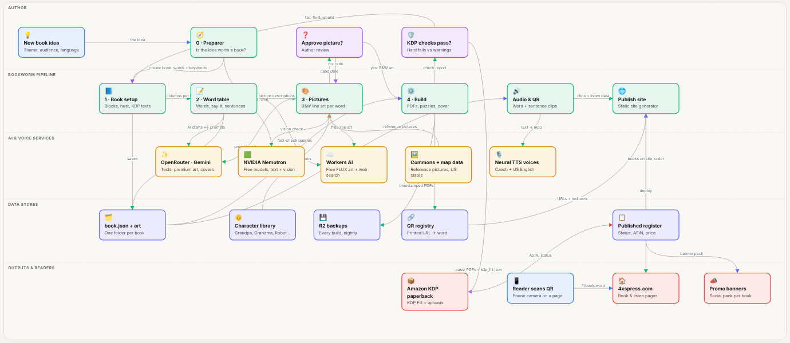
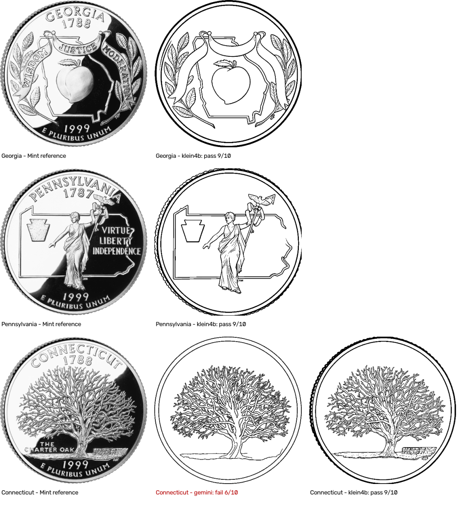
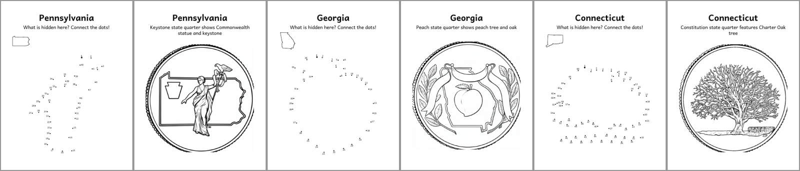
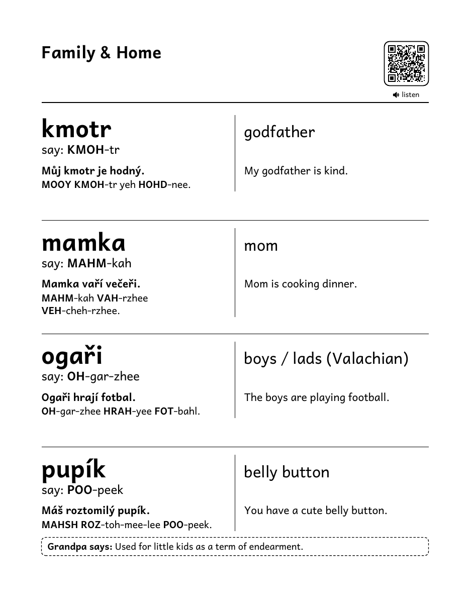

# Bookworm — 4XS Press KDP publishing platform

**From book idea to Amazon KDP paperback in hours, not weeks.**

Bookworm is the one-person publishing platform behind [4XS Press](https://4xspress.com). It checks a book idea against real Amazon signals, builds a KDP-compliant interior and cover, gives every word a printed QR code that plays its pronunciation, and publishes the book's page on 4xspress.com. The words and the final check stay human; everything else is automated.

> This repository presents the platform. Bookworm itself is a private tool and its source code isn't public.

## What it does

| Step | What happens |
|---|---|
| **0 · Preparer** | Amazon search suggestions + a results screenshot read by a free vision model → scorecard (potential, niche, risks, titles, keywords) and the first 20 words. "Create book" carries them over |
| **1 · Book** | Audience (kids / seniors / adult), language (English or Czech–English), host character, page blocks, AI-drafted KDP description with only true facts, keywords, categories, cover |
| **2 · Words** | One editable table: word, say-it, translation, sentences, notes, clues. AI fills gaps, facts are web-checked, sources are never printed |
| **3 · Pictures** | B&W line art per word with consistent characters. Real subjects are traced from reference pictures (Wikimedia Commons) and checked by a vision model |
| **4 · Build** | interior.pdf, cover.pdf, KDP metadata and form-fill data, KDP rules enforced as build checks |
| **Publish** | Audio + QR listen pages, Published register, promo banner pack, one-click 4xspress.com deploy |

## Highlights

- **Scan & hear every word:** permanent QR addresses on 4xspress.com, so audio can become video without reprinting.
- **Pictures from real references** (new in 2.16): trace, then a free vision check against the reference.
- **Reveal dot-to-dot:** the object hidden in numbered dots, the full picture to color overleaf.
- **Large print that never overlaps:** fewer words per page instead of shrinking; a word search fills a page left a third empty.
- **KDP compliance built in:** margins, spine, 24–590 pages, pure B&W art, cover text 0.375 in inside the trim, keyword rules.
- **Promo banners:** a social pack per book in the cover's colours, drawn in code.
- **Mostly free:** Cloudflare Workers AI, free NVIDIA Nemotron models, neural TTS; paid Gemini only per click.

| | |
|---|---|
|  |  |
|  |  |

## More

- **Landing page:** [`docs/index.html`](docs/index.html) (GitHub Pages: Settings → Pages → Deploy from a branch → `/docs`)
- **Interactive workflow:** [`docs/workflow.html`](docs/workflow.html)
- **Full specification** (also the NotebookLM source): [`docs/BOOKWORM_SPEC.md`](docs/BOOKWORM_SPEC.md)
- **Books:** [4xspress.com](https://4xspress.com)

---

Bookworm 2.16.6 · © 2026 Pavel Kotyza · 4XS Press
