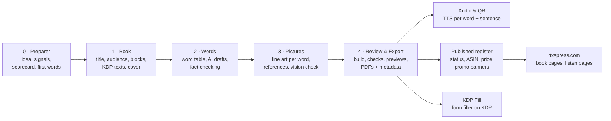
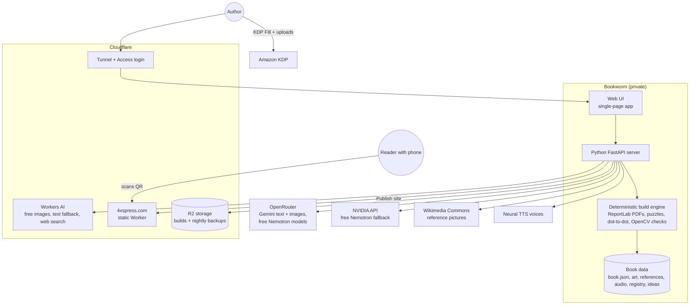

# Bookworm — 4XS Press KDP Platform Specification

**Version:** spec 1.1 · Bookworm 2.16.6 · 3 November 2026
**Publisher:** 4XS Press · [4xspress.com](https://4xspress.com)
**Author:** Pavel Kotyza

> Bookworm is a one-person publishing platform that turns a book idea into a print-ready Amazon KDP paperback: interior PDF, wrap-around cover, Amazon metadata, a "scan and hear every word" audio layer, promo banners and a page on the publisher website. One book takes hours instead of weeks. The words and the final check stay human; everything else is automated.

---

## 1. Summary

| | |
|---|---|
| **What it is** | A private web app that runs the whole book pipeline: idea → book → words → pictures → review and export → publish |
| **Who uses it** | One author/publisher, from a desktop, laptop or phone |
| **What it makes** | KDP paperbacks (8.5 × 11 in, black & white interior, colour cover), print-at-home PDFs, audio listen pages, social promo banners, the publisher website |
| **Signature feature** | Every word in a book has a printed QR code that plays its pronunciation. The code points at a permanent address the publisher controls, so the audio can be upgraded (for example to video) without reprinting |
| **Book formats** | 12 starting templates and 10 combinable content blocks (coloring, dictionary, dot-to-dot, reveal dot-to-dot, word search, crossword, fun facts, trivia quiz and others) |
| **Languages** | English (default) or Czech–English bilingual |
| **Audiences** | Kids, seniors (large print), adults: one visual style per audience |
| **Catalog** | 16 titles in Bookworm, 15 registered for KDP: 5 live, 10 in review (3 Nov 2026) |
| **Running cost** | Mostly free tiers. Paid per use only for premium AI images and texts |

---

## 2. Problem and why it exists

Self-publishing activity and learning books on Amazon KDP is repetitive and error-prone:

- Every title needs the same work: content, consistent illustrations, puzzles with solutions, a KDP-compliant interior, a cover with an exact spine width, keywords, categories and a description.
- KDP rejects books for small technical problems: text too close to the cover edge, grey shading in line art, page counts out of range, cover and print settings that don't match.
- AI image tools draw a character differently every time, invent details of real objects, and misspell small text on covers.
- Picking the wrong niche wastes a whole book's work.
- A printed book is static. A learner can't *hear* a foreign word on paper.

Bookworm turns this into a repeatable pipeline. The author does the creative and editorial work (ideas, themes, word lists, review), and the platform handles idea checks, layout, compliance, art consistency, audio, promotion and publishing.

---

## 3. Product lines (current catalog)

| Line | Examples | Audience |
|---|---|---|
| **Texas Czech heritage** ("Grandpa" series) | *Learn Czech with Grandpa: 50 First Words*, *Jejdanečky! Texas Czech Coloring & Puzzle Book*, *Texas Czech Bad Words*, *From Moravia to Texas with Grandpa*, *Texas Czech Words* (large-print dictionary) | Czech-American families, diaspora grandparents, heritage gift buyers |
| **Czech traditions** | *Czech Christmas Tradition*, *Czech Easter Tradition* coloring & word puzzle books | Heritage and gift |
| **Prague and travel** | *Prague Transportation Dot-to-Dot* (kids), *Prague Tour Dot-to-Dot: High Detail* (adults), *Czech for Travelers* (planned) | Kids, adults, pre-trip learners |
| **Bitcoin** | *Bitcoin for Kids*, *Bitcoin for Seniors* | Families, seniors |
| **AI and technology** | *My First AI Coloring & Puzzle Book*, *Learn about AI the Fun Way!*, *Security Cameras Coloring & Puzzle Book* | Kids, seniors |
| **Americana** (in progress) | *State Quarter Dot-to-Dot for Kids*: each state's quarter motif hidden in dots, the full coin design to color overleaf | Kids, coin-collecting families |
| **Fun facts and trivia** | Large-print fact, quiz and fact+quiz books | Seniors |

---

## 4. The workflow

### Step 0: Preparer (idea check)
A separate tab for ideas, so nothing becomes a book until it is worth one. Ideas can be deleted freely.

1. **Signals (real data):**
   - Amazon Books search-box suggestions for the idea and for the idea + a…z. No suggestions means few people type it.
   - A screenshot of the Amazon search results: a free vision model reads the result count, titles, prices, reviews and stars from it.
   - Free-text notes.
2. **Scorecard:** verdict go / maybe / no, potential 1–5 (buyers, gift occasions, channels, price), niche 1–5 (competition, best Bookworm book type, series options), risks with how to check each (for example design rights or trademarks), 3 title options and 7 keywords. The model must say "unknown" instead of inventing search volumes or sales.
3. **First 20 words** (+10 more), editable.
4. **Discuss:** a saved chat about the idea, with the signals and scorecard as context.
5. **Verdict:** park, kill, or **Create book**: the book is created with the words and keywords already filled in.

It runs on **free NVIDIA Nemotron models** (OpenRouter free tier, NVIDIA's own API as a fallback). Slow model calls run in the background, and the page shows progress.

### Step 1: Book
- Title, subtitle, theme, intro text, back-cover text, price.
- **Audience** (kids / seniors / adult) fixes fonts, line weight, single- or double-sided pages and large print.
- **Language**: English or Czech–English.
- **Book host**: a recurring illustrated character (Grandpa, Grandma, the grandkids, Robot…) or none.
- **Blocks**: the book's content in order (see §5). Templates fill in a typical recipe.
- **KDP metadata**: AI-drafted description in Amazon's feature-list style, 7 backend keywords, 3 categories. The AI may claim only facts the platform knows to be true about the book: page count, audio, large print, solutions.
- **Cover**: generated, uploaded, or made with Gemini (see §8).

### Step 2: Words
- One editable table holds every entry: word, translation, pronunciation guide ("say-it"), example sentence (both languages), cultural note, crossword clue, picture description, which characters appear.
- AI drafts new rows or fills empty cells, batch by batch, and the table updates live. The author edits, reorders (drag, to top, one up / one down), approves, or excludes a row without deleting it.
- Fact books use web-search grounding: facts are drafted only from search results, then fact-checked one by one and marked verified yes/no with a source. **Sources and review notes are stored separately and never printed.**

### Step 3: Pictures
- One black-and-white line drawing per word, made by a free engine (FLUX.2 Klein on Cloudflare Workers AI) or a premium one (Gemini).
- Character reference sheets are attached to every prompt, so the host looks the same in every book.
- **Reference pictures (new in 2.16):** for real subjects (coins, landmarks, objects), each word can get a reference picture: found on Wikimedia Commons in one click (licence, author and source page stored), or uploaded. The engine then **traces the real picture** instead of drawing from imagination: the full design for coloring pages, or one simple object for dot-to-dot. "Find missing references" fills a whole book from one search pattern (for example "{word} quarter reverse").
- **Free vision check:** after each picture made from a reference, a free vision model compares it with the reference and reports pass/fail, a 1–10 score, invented or missing parts, and any lettering left in the picture.
- Automatic checks: grey or colour pixels (KDP prints pure B&W best), single-object check for dot-to-dot.
- Approving a picture snaps it to pure black and white. Earlier versions are kept.

### Step 4: Review & Export
- **Build** produces `interior.pdf`, `cover.pdf`, the metadata sheet and a print-ready PDF for private sale.
- Hard checks (block the build) and soft warnings (see §9).
- Page previews in the browser, full-screen preview, download links.
- Every build is backed up to cloud storage with a timestamp.

---

## 5. Content blocks

A book is an audience + language + an **ordered list of blocks**. Each block can use all words, a range, or selected themes.

| Block | What the reader gets |
|---|---|
| **Coloring pages** | One big picture per word with the word, meaning, pronunciation, example sentence and host's note. Optional puzzles between pages |
| **Coloring dictionary** | Picture-dictionary page per word |
| **Dictionary (words per page)** | **Up to** 5 words per page in two halves (Czech left with say-it and sentence, English right), host's note in a box. A page takes fewer words when long notes would not fit in large print, so text never overlaps. A page left a third or more empty gets a small word search from that chapter's words, answers at the back. Optional puzzle on the facing page |
| **Dot-to-dot** | Each word's object as a connect-the-dots puzzle, solution at the back |
| **Reveal dot-to-dot + coloring** (new) | A page pair per word. Right-hand page: "What is hidden here? Connect the dots!", only numbered dots (no lines that give it away), and a small US-state map when the word is a state. Overleaf: the full picture to color, which is also the answer |
| **Landmark dot-to-dot** | High-detail dot-to-dot of real landmarks in three difficulty levels (seniors ~100–200 dots, relaxing ~250–400, extreme ~400–650) |
| **Word searches** | Generated grids, solutions at the back |
| **Crosswords** | Generated crosswords mixing the latest words with review words from earlier pages, so they're not too easy |
| **Fun facts** | "Did You Know?" pages, 4 facts per page, large print |
| **Trivia quiz** | Multiple-choice quizzes (A–D) with an answer key explaining each answer |

Every book also gets a title page, copyright page, intro, optional "Listen to every word!" page, solutions and a **cross-promo page** with up to 4 other books (picked per book) and a QR code to the publisher site.

**Starting templates:** coloring dictionary, coloring book, dot-to-dot, dictionary, dictionary + puzzles, crosswords, word searches, puzzle mix, fun facts, trivia quiz, facts + trivia, landmark dot-to-dot.

---

## 6. Audio layer: "Scan & hear every word"

The main differentiator.

- **Text-to-speech** for every word and its example sentence: slow, clear neural voices (a Czech male voice for Grandpa, a Czech female voice for female characters, an American English male voice for English books).
- **Printed QR codes**:
  - a large "Listen to every word!" code near the start of the book,
  - a small code in the corner of every dictionary and coloring page,
  - one code per page on multi-word dictionary pages.
- **Permanent addresses:** every code points to a page on 4xspress.com (`/l/<book>/<word>`), not to an audio file. What the page plays can change later (mp3 today, video tomorrow) **without reprinting**.
- **Safety rules:**
  - A registry records every printed URL and the word it stands for, and the build warns if a URL would now mean a different word.
  - IDs are never reused or renumbered once printed.
  - A book's code name is locked once the book is uploaded to KDP. Before that, a rename leaves redirects from the old name.
  - Unknown addresses redirect safely and never loop.
- **Public vs. book-only:** the website shows a short preview (first 2 words). The full audio is reached by scanning the book.
- Audio is recorded in the background; the clip count updates live on the page.
- Covers carry a round **"WITH AUDIO · scan & listen"** seal, and subtitles say so.

---

## 7. Characters

- A **shared character library** for all books. Each character has a full reference set, line art and colour:
  - turnaround: front, three-quarter, side, back,
  - 4 poses: wave, point, read, hold,
  - 6 expressions: happy, laugh, proud, sleepy, surprised, thinking,
  - a colour master.
- Each character set is generated as **one image cut into figures**, so the face stays the same across figures.
- Pairs (for example the grandkids) are always drawn together.
- A book's **host** can appear in a chosen share of the pictures (for example every 3rd), with rotating poses, so the book looks consistent.
- Characters are fictional and drawn in one shared coloring-book line style.

---

## 8. Covers

- **Wrap template from the book data:**
  - 0.125 in bleed,
  - spine width = pages × paper factor,
  - spine text only above 79 pages,
  - barcode area kept clear,
  - publisher mark on the back,
  - exported as a 300 DPI PDF.
- **Mandatory rules after a real KDP QA rejection:**
  1. All cover text at least **0.375 in inside the trim**.
  2. AI front art is never full-bleed. It is fitted inside the safe area and the edges are filled with a **mirrored, blurred extension** of the art.
  3. The "WITH AUDIO" seal is placed automatically where on-image text detection finds **no text**.
- **Gemini covers** (in progress, "Cover Studio"):
  - Gemini 3.1 Flash Image at 4K: ~$0.15 per image, enough resolution with no upscaling.
  - Gemini draws only the big lettering. Small word labels are rendered **in code** from the real word list, because AI invents or misspells small text.
- Per-series cover themes (fonts checked for Czech diacritics, palettes, lettering modes): Texas Czech folk, 1930s travel poster, Bitcoin orange, geometric AI, sport.

---

## 9. KDP compliance built in

| Area | Rule enforced |
|---|---|
| Trim / paper | 8.5 × 11 in, black & white interior, white paper, no bleed |
| Page count | 24–590 pages (white); single-sided books keep art on right-hand pages |
| Margins | Inside margin by page count (≥ 0.375 in up to 150 pp, ≥ 0.5 in up to 300 pp); house preset 0.75 in all round |
| Spine | pages × 0.002252 in (white) / 0.0025 in (cream); spine text only > 79 pages |
| Cover | Text ≥ 0.375 in from trim, mirrored edges, barcode zone clear, 300 DPI recommended |
| Art | Pure black & white, grey/colour pixel check, single-object check for dot-to-dot, vision check against the reference picture |
| Large print | Seniors body text 19 pt, never below 16 pt; dictionary pages take fewer words instead of overlapping |
| Metadata | 7 keywords ≤ 50 chars each, warning when keywords repeat title words, description HTML ≤ 4000 chars, banned medical-claim terms, title + subtitle ≤ 200 chars |
| Content hygiene | Review notes and source citations can never reach printed text |
| Rights | Reference pictures keep licence, author and source; image credits go on the copyright page (for example "Quarter-dollar coin images from the United States Mint") |
| AI disclosure | AI-generated images flagged in the metadata for KDP's disclosure form |
| Print options | Metadata sheet lists the exact KDP print settings, because a mismatch makes the KDP previewer crop the cover |

---

## 10. Publishing and distribution

- **Published register:**
  - one row per book: status (draft / in review / live / blocked / unpublished), ASIN, price, category, site order, "on site" toggle,
  - estimated royalty per copy from the KDP print-cost model,
  - download links for the last build's PDFs.
- **Promo banners:** one click makes a banner per book in the colours of its own cover, plus a social pack (poster, Instagram post and story, square, Facebook post and cover, LinkedIn post and banner, YouTube thumbnail and banner). Banners show the real cover, a real interior page, a "N pages" badge, the "scan the QR codes" line for audio books and the 4xspress.com link. Drawn in code, so every word is spelled right.
- **KDP Fill:** a bookmarklet on kdp.amazon.com that fills the paperback form from the book's exported data:
  - Details tab, tested: title, subtitle, author, rich description, copyright, audience, reading age, marketplace, keywords and up to 3 categories in KDP's own category tree.
  - Content tab (paper, bleed, finish, AI disclosure): written, not yet tested on a draft.
  - It never saves, publishes, assigns ISBNs or uploads files. Those stay with the author.
- **4xspress.com publisher site**, generated from the register and deployed with one click:
  - home shelves grouped by series,
  - one page per book: cover zoom, "Look inside" previews, listen demo, Amazon or "coming soon" links,
  - listen pages per book and per word,
  - light/dark theme.
- **Print-at-home PDFs:** a planned "all PDFs" bundle and free sample PDFs. KDP paperback rights are non-exclusive, so selling PDFs elsewhere is allowed (KDP ISBN and barcode are kept off them).
- **Word videos:** short watercolor "word" videos (vertical, YouTube Shorts) can attach to a word's listen page.

---

## 11. Architecture

- **Server:** Python 3.12, FastAPI, about 6,700 lines across the app, build engine, page layouts, puzzle generators, dot-to-dot engines, character tools, idea Preparer, banner generator, site builder and sync.
- **Front end:** one HTML/JS single-page app (~1,000 lines), no framework.
- **Build engine:** deterministic and runnable on its own from the command line. Fonts embedded, puzzles verified, solutions generated.
- **Long jobs** (AI model calls, audio recording) run in the background and the page checks progress every few seconds, so nothing hits the 100-second request limit of the tunnel. All data responses are marked "do not store", so counts update without reloading.
- **Map data:** US state outlines from US Census data (public domain), drawn as vectors.
- **Hosting today:** runs on a home Mac mini, reachable from anywhere through Cloudflare Tunnel with an email-code login (Cloudflare Access).
- **Prepared, not yet switched on:** the same app in a Cloudflare Container that sleeps when idle, with data in R2. Then the home machine can be off.
- **Backups:** every build's PDFs go to R2 with a timestamp, plus a nightly full backup.
- **Data model:** one `book.json` per book (texts, words, blocks, cover, KDP metadata, audio settings), an art folder per book with reference pictures, a shared character library, the published register, the QR registry and the idea list.

---

## 12. AI usage and cost model

| Task | Engine | Cost |
|---|---|---|
| Line-art pictures (default), also traced from reference pictures | FLUX.2 Klein on Cloudflare Workers AI | Free tier (~100 pictures/day) |
| Line-art pictures (premium) / character sheets | Gemini 3.1 Flash Image via OpenRouter | Pay per image, shown in the UI |
| Front covers | Gemini 3.1 Flash Image, 4K | ~$0.15 per image |
| Texts (descriptions, sentences, intros, clues) | Gemini 2.5 Flash via OpenRouter; Workers AI fallback | Cents per book |
| Idea scorecard, first words, idea chat | NVIDIA Nemotron 3 Ultra / 3.5 Lightning (free) | Free |
| Reading Amazon screenshots, picture-vs-reference check | NVIDIA Nemotron 3.5 Super VL (free, vision) | Free |
| Fact grounding + fact-check | Cloudflare web search via AI Gateway | Gateway credits |
| Word and sentence audio | Neural TTS | Free |
| PDF builds, puzzles, dot-to-dot, banners, checks | Local code | Free |
| Hosting, login, site, backups | Cloudflare free tiers | Free (domain renewal yearly) |

The header shows live usage: free image allowance left today and premium AI spend. Free models are tried in order; if one is busy or fails, the next one takes over.

**Human in the loop:** AI drafts, the author decides. Ideas, word lists, facts, pictures and covers each have an explicit approve step. AI may only claim facts the platform can verify, and nothing unverified or editorial is printed.

---

## 13. Quality principles

1. **Preview = final.** Draft PDFs are built exactly like the final ones.
2. **Never print notes.** Sources, review flags and citations live in separate fields.
3. **Permanent QR addresses.** Printed codes never change meaning.
4. **Compliance before upload.** KDP rules are build checks, not after-the-fact rejections.
5. **One style per audience.** Consistent fonts, line weights and characters across a series.
6. **Real data before AI opinion.** Idea checks start from Amazon signals, pictures of real things start from real reference pictures.
7. **Cheap by default.** Free engines first; paid AI is a deliberate click with its cost shown.
8. **Versioned tool.** Every change bumps the visible version number.

---

## 14. Roadmap

| Status | Item |
|---|---|
| In progress | **State Quarter book**: reveal dot-to-dot + coloring for all 56 quarters (50 states, DC, 5 territories) |
| In progress | **Cover Studio**: Gemini covers per series theme, code-rendered word labels, automatic text check |
| In progress | **KDP Fill**: test the Content tab on a draft; automate trim size, AI-disclosure details and pricing |
| Planned | **Topic packs**: shared, checked items (facts, quiz, reference picture, shape) that feed several books, e.g. one quarters pack → dot-to-dot, coloring, fun facts, trivia, collector checklist |
| Prepared | **Cloud Bookworm**: Cloudflare Container + R2, so the home machine can be off |
| Planned | **Czech for Travelers** series: pre-trip workbook with phrases, puzzles and audio on every phrase |
| Planned | **Moravian heritage** two-book set; Grandma-hosted books |
| Planned | Print-at-home PDF bundle and free sample PDFs on 4xspress.com |
| Planned | Video per word on listen pages (QR addresses already support it) |
| Open | Trim sizes beyond 8.5 × 11 (6 × 9 for travel); Kindle eBook covers |

---

## 15. Glossary

- **KDP**: Amazon Kindle Direct Publishing, Amazon's self-publishing platform for print-on-demand paperbacks and eBooks.
- **Trim / bleed**: the final page size / extra art past the trim line that is cut off.
- **Say-it**: a simple English-letter pronunciation guide printed under each word.
- **Host**: the recurring character who guides the reader through a book.
- **Block**: one content section of a book (coloring, dictionary, puzzles…).
- **Preparer**: the idea-check tab: real Amazon signals, an AI scorecard and first words before a book exists.
- **Reference picture**: a real photo or official image a line drawing is traced from, stored with its licence.
- **Reveal page**: a dot-to-dot that shows only numbered dots; the finished picture is overleaf to color.
- **Listen page**: the web page a printed QR code opens; plays the word and sentence audio.
- **Published register**: the platform's list of books with KDP status, ASIN and price.

---

*Bookworm is a private tool. This document describes its features and architecture; the source code isn't public.*
*© 2026 Pavel Kotyza · 4XS Press*
